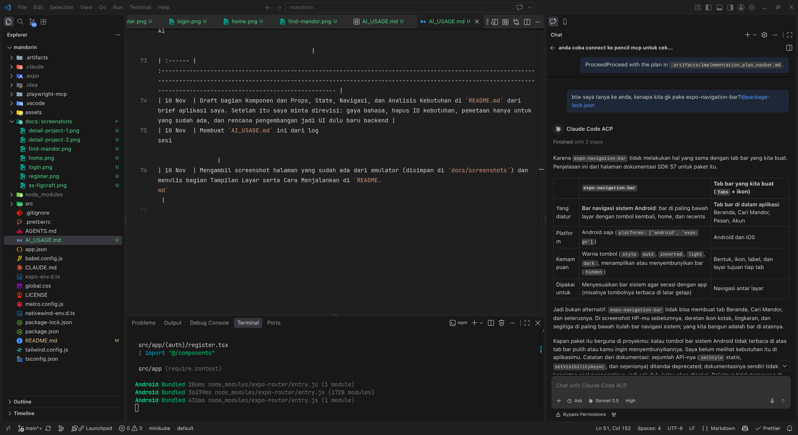
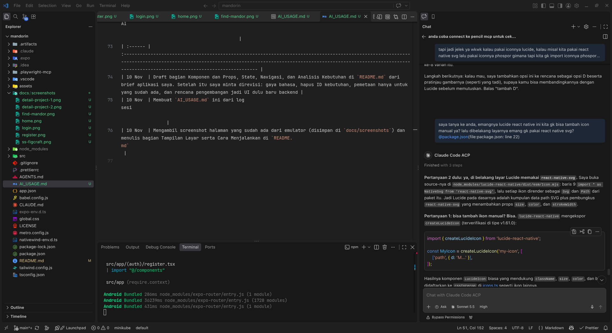
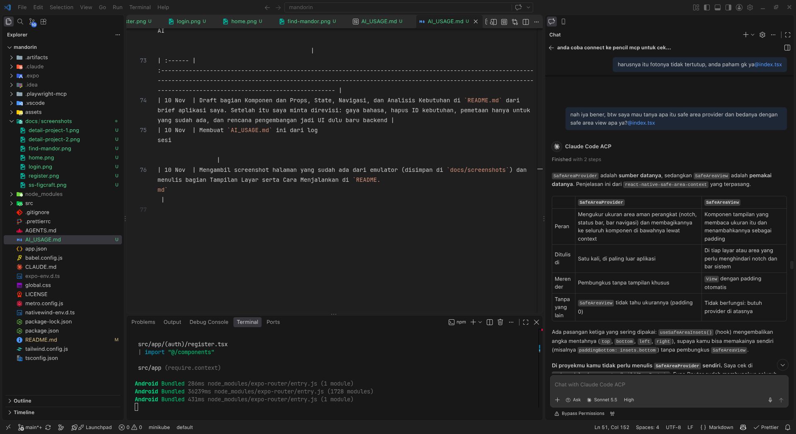
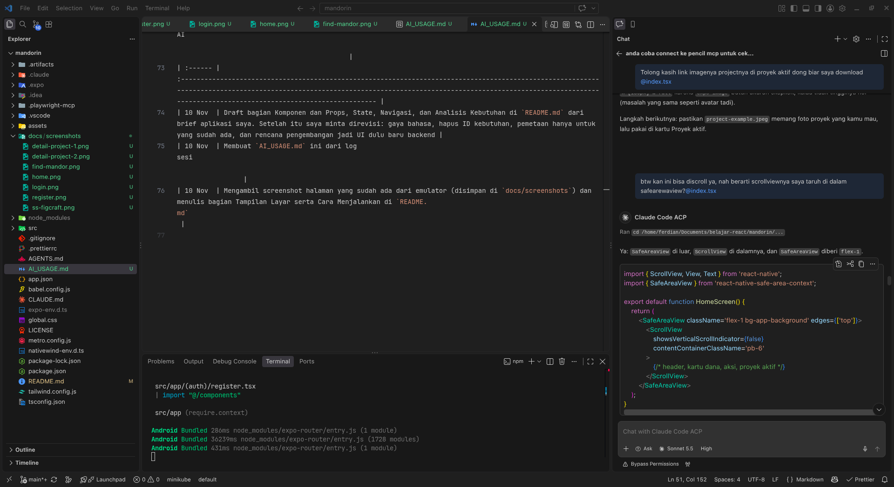
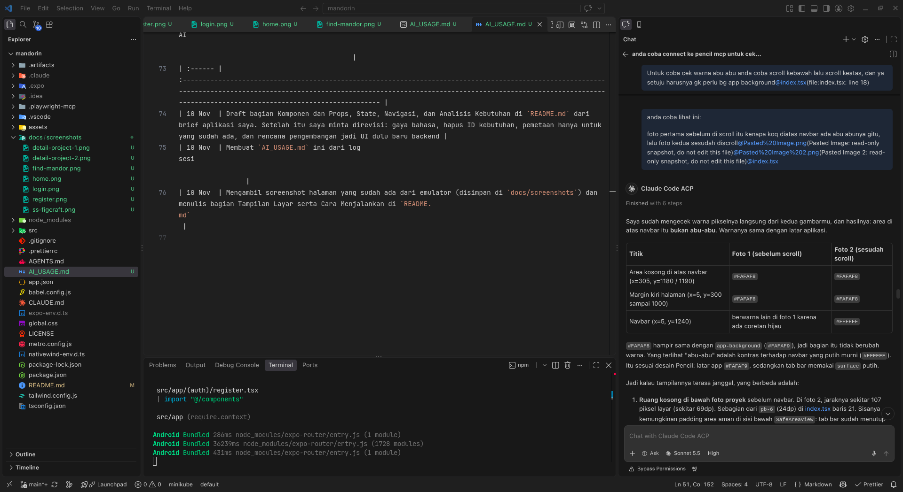
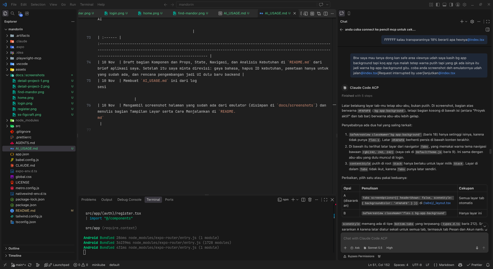
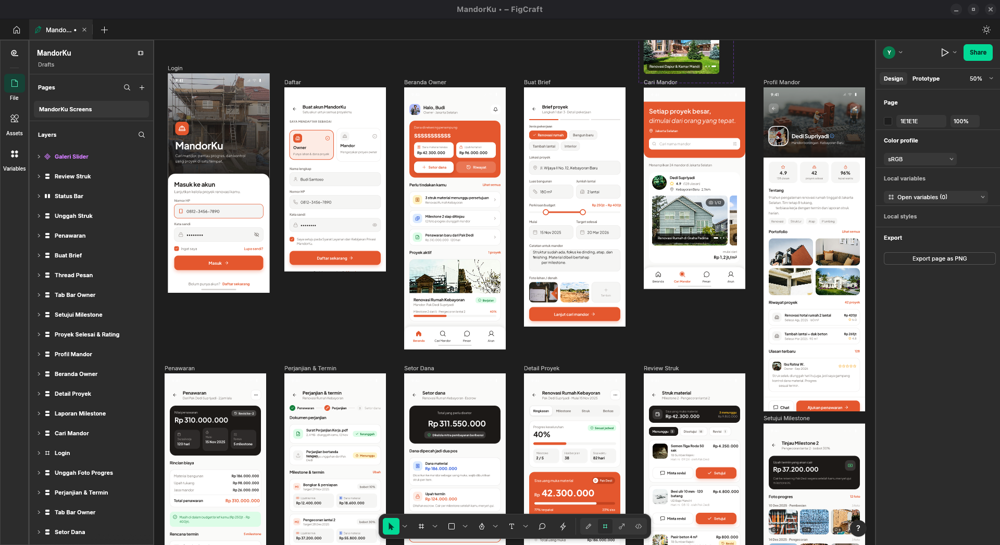

# AI Usage

Catatan bantuan AI selama mengerjakan Mandorku. Isinya disusun dari log sesi Claude Code yang tersimpan untuk project ini (30 Sep sampai 10 Nov 2026), jadi yang tercatat hanya yang memang ada di log. Tanggal memakai waktu lokal (WITA).

## Tools

- **Claude Code** (Anthropic) di VS Code, model Claude (paling banyak Sonnet 5.5).
- **MCP Pencil** untuk membaca dan mengubah desain `mandorku.pen`.
- **MCP Figcraft** untuk membuat ulang dan mengubah desain di Figcraft.

## Cara saya pakai AI

1. Paling sering tanya jawab: konsep React Native, NativeWind, Expo Router, dan best practice. Kodenya saya tulis dan saya sesuaikan sendiri.
2. Desain UI (Pencil dan Figcraft) seluruhnya dibuat dengan AI. Detailnya ada di bagian "Desain ke kode".
3. Minta AI membaca desain Pencil untuk mengambil warna, nama icon, ukuran, radius, dan link gambar.
4. Minta AI mengedit kode untuk bagian tertentu. Untuk perubahan yang besar (navbar dan refactor komponen) AI membuat implementation plan dulu dan saya review sebelum dikerjakan.
5. Minta saran commit message. Semua `git commit` saya jalankan sendiri, AI tidak pernah commit atau push (dicek di log).

## Log bantuan

### Setup dan tooling

| Tanggal   | Bantuan AI                                                                                                                                                                                                                                                                         |
| :-------- | :--------------------------------------------------------------------------------------------------------------------------------------------------------------------------------------------------------------------------------------------------------------------------------- |
| 26-28 Okt | Cara menjalankan Android emulator yang ringan, menampilkan emulator di VS Code (scrcpy), dan membuat script `emulator.sh` (disimpan di luar repo, di folder `belajar-react`). AI sempat membuat `.vscode/launch.json` untuk Radon IDE, lalu dihapus lagi karena tidak jadi dipakai |
| 29 Okt    | Cara format on save dengan Prettier, dan saran commit message                                                                                                                                                                                                                      |
| 5 Nov     | Cara mematikan urutan class Tailwind otomatis dari Prettier. AI menghapus konfigurasinya di `.prettierrc`                                                                                                                                                                          |

### Belajar konsep dan debugging

| Tanggal   | Bantuan AI                                                                                                                                                                                                                                                    |
| :-------- | :------------------------------------------------------------------------------------------------------------------------------------------------------------------------------------------------------------------------------------------------------------ |
| 13 Okt    | Kenapa bagian atas layar kosong, teks mulai dari paling atas, dan gambar tidak muncul (`contentFit`). AI sempat mengedit `login.tsx` padahal saya hanya bertanya, jadi saya minta revert                                                                      |
| 26 Okt    | Arti `export default function` dan hubungannya dengan Expo Router, serta strategi halaman login dan register                                                                                                                                                  |
| 26-29 Okt | Pertanyaan styling NativeWind saat membuat login, register, dan beranda: rem vs px, rounded, line height, `inset-0`, gradient, `hitSlop`, `onFocus` dan `onBlur`, font dengan expo-font, `SafeAreaView` vs `SafeAreaProvider`, `ScrollView`, dan progress bar |
| 29 Okt    | Bagaimana membuat card pilihan Owner atau Mandor di register berubah warna (state)                                                                                                                                                                            |
| 9 Nov     | Kenapa `edges` di `SafeAreaView` pada detail project tidak berpengaruh                                                                                                                                                                                        |
| 10 Nov    | Diskusi komponen reusable dengan hooks dan props: apa yang layak dijadikan komponen, kenapa pakai `className`, cara custom warna dua bagian `ProgressBar`, dan cara menambah validasi                                                                         |

### Screenshot percakapan

Berikut screenshot beberapa percakapan saya dengan Claude Code di VS Code (diambil 10 Nov dari riwayat chat). Isinya tanya jawab dan analisis.

**Kenapa tidak pakai `expo-navigation-bar`?** AI menjelaskan paket itu mengatur bar navigasi sistem Android, bukan tab bar di dalam aplikasi.

**Icon Lucide dan `react-native-svg`.** Soal icon navbar yang terlihat jelek dengan Lucide, apakah bisa menambah icon manual, dan apakah Lucide memakai `react-native-svg` di belakang layar.

**`SafeAreaProvider` vs `SafeAreaView`.** Perbedaan keduanya dan kenapa Expo Router sudah memasang provider otomatis.

**`ScrollView` di dalam `SafeAreaView`.** Urutan pembungkus untuk halaman beranda yang bisa di-scroll, dan kenapa perlu `flex-1`.

**Area abu-abu di atas navbar.** AI mengecek warna piksel dari dua screenshot saya dan menemukan warnanya sama dengan latar aplikasi, hanya terlihat abu-abu karena navbar putih.

**Latar layar tab.** Kenapa bagian kosong di bawah isi berwarna abu-abu (warna tema navigasi bawaan) dan cara mengaturnya lewat `sceneStyle`.

### Desain ke kode (Pencil dan Figcraft)

| Tanggal   | Bantuan AI                                                                                                                                                                                                                   |
| :-------- | :--------------------------------------------------------------------------------------------------------------------------------------------------------------------------------------------------------------------------- |
| 26-29 Okt | AI membaca `mandorku.pen` lewat MCP Pencil untuk mengambil palet warna, nama icon, ukuran, radius, padding, dan link gambar. Hasilnya saya pakai di `tailwind.config.js` dan layar login, register, serta beranda            |
| 26 Okt    | AI mengganti nama variabel warna di `mandorku.pen` ke nama semantik (`primary`, `muted`, dan seterusnya) supaya sama dengan token di `tailwind.config.js`                                                                    |
| 28 Okt    | Saran warna untuk card "Kartu Dana" yang terlihat terlalu hitam. AI mengubah warnanya di `mandorku.pen` jadi `primary` dan putih                                                                                             |
| 29 Okt    | Karena kuota MCP Pencil habis, AI membaca export HTML dari Pencil untuk membuat navbar                                                                                                                                       |
| 10 Nov    | AI membuat ulang desain `mandorku.pen` di Figcraft lewat MCP, menyesuaikan halaman detail proyek dengan referensi HTML saya, dan membuat desain slider foto di card find-mandor. Semua ini di aplikasi desain, bukan di repo |

Seluruh desain MandorKu (Pencil dan Figcraft) dibuat dengan AI. Sesi pembuatan awal desain di Pencil tidak ada di log Claude Code yang tersedia, jadi tabel di atas hanya mencatat yang terlihat di log: membaca desain, dua perubahan di `mandorku.pen`, dan membuat ulang desain di Figcraft. Berikut tampilan project desain di Figcraft:

### Kode yang diedit AI atas permintaan saya

| Tanggal   | File                                                        | Yang dikerjakan                                                                                                                                                                                                 |
| :-------- | :---------------------------------------------------------- | :-------------------------------------------------------------------------------------------------------------------------------------------------------------------------------------------------------------- |
| 26-27 Okt | `tailwind.config.js`                                        | Token warna (nama semantik dan `secondary`)                                                                                                                                                                     |
| 26-27 Okt | `src/app/(auth)/login.tsx`                                  | Merapikan ukuran yang meleset dari desain, posisi icon mata di input sandi, dan border input yang berubah saat fokus                                                                                            |
| 27 Okt    | `src/app/(auth)/_layout.tsx`                                | Setup font Plus Jakarta Sans dan log untuk mengecek font sudah terload                                                                                                                                          |
| 29 Okt    | `src/app/(auth)/register.tsx`                               | Memperbaiki error dan membuat card Owner dan Mandor bisa dipilih                                                                                                                                                |
| 29-30 Okt | `src/components/icons.ts`, komponen icon navbar, layout tab | Navbar dengan icon custom SVG, termasuk memasang `react-native-svg` lewat `npx expo install`. Dikerjakan lewat implementation plan yang saya review dulu (file icon navbar sekarang bernama `navbar-icons.tsx`) |
| 10 Nov    | `src/app/(owner)/detail-project.tsx`                        | Bagian milestone dengan data hard code, lalu mengganti ukuran px ke rem (dan ke class seperti `p-3.5` untuk nilai rem yang aneh)                                                                                |
| 10 Nov    | `src/app/(owner)/detail-project.tsx`                        | Memeriksa kenapa spacing kartu Laporan M1 dan Perjanjian terlihat aneh. Hanya analisis, tidak ada edit                                                                                                          |
| 10 Nov    | Semua halaman yang memakai `Text`                           | AI mengecek class `font-jakarta` yang belum ada. Hanya pengecekan, tidak ada edit AI di bagian ini                                                                                                              |
| 10 Nov    | `assets/images`                                             | AI membuat daftar foto yang tidak terpakai, lalu saya yang menghapusnya                                                                                                                                         |

### Dokumentasi

| Tanggal | Bantuan AI                                                                                                                                                         |
| :------ | :----------------------------------------------------------------------------------------------------------------------------------------------------------------- |
| 10 Nov  | Membuat `AI_USAGE.md` ini dari log sesi                                                                                                                            |
| 10 Nov  | Mengambil screenshot halaman yang sudah ada dari emulator (disimpan di `docs/screenshots`) dan menulis bagian Tampilan Layar serta Cara Menjalankan di `README.md` |
