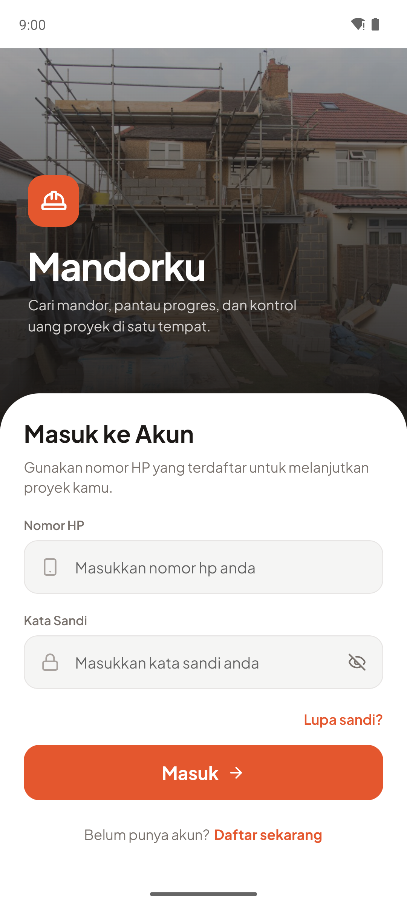
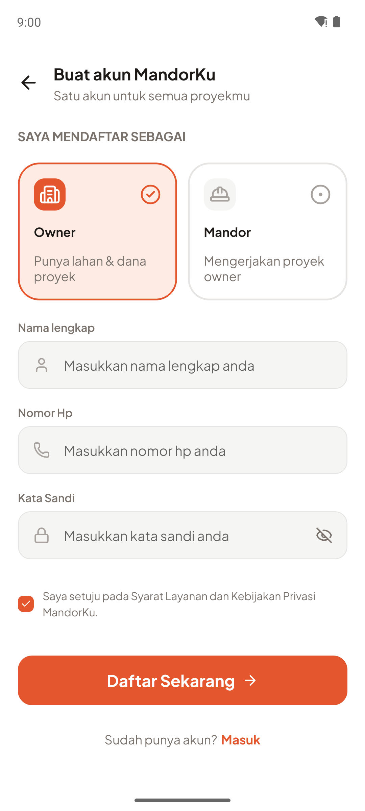
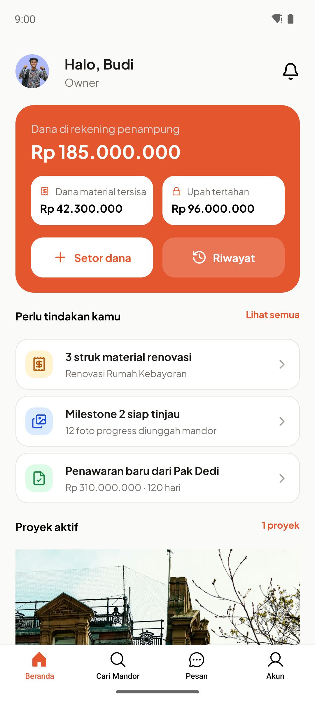
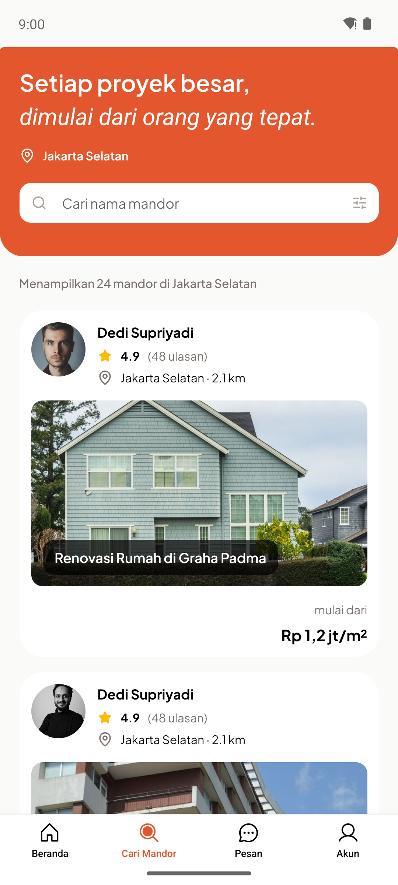
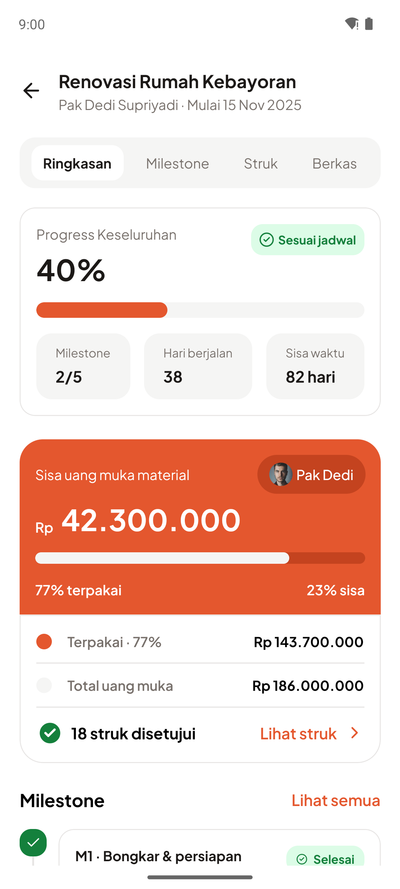
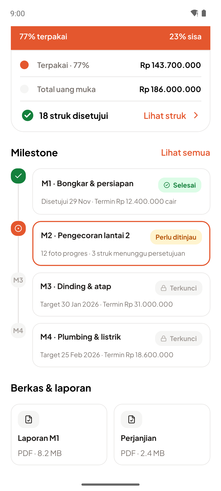

## Apa itu React Native

React Native adalah framework open source yang dibuat oleh Meta(Facebook) untuk membuat aplikasi mobile (android dan ios) menggunakan React Js dan Javascript/Typescript. Keunggulan dari menggunakan react native adalah:

1. Satu codebase untuk 2 plaform yaitu Android dan Ios
2. Develop lebih cepat karena cukup punya 1 tim saya untuk buat aplikasinya yang nanti digunakan di android dan ios sehingga sekali 1 development cycle itu langsung bisa rilis 2 platform. Tanpa perlu ngoding 2 kali untuk masing masing platform
3. Ekosistem JS/TS/React dan talent pool yang besar

## Cara Kerja React Native


Ketika aplikasi dibuild maka isinya ada hermes engine (js engine), codingan kita, fabric, dan native code lainnya yang jadi depedency untuk akses fitur native seperti kamera,dll. Ketika jalan maka mekanismenya seperti ini:

1. Hermes engine menjalankan codingan react native kita lalu menghasilkan object yang ingin dirender.
   Contoh;

```react
<View>
  <Text>Halo</Text>
  <Button title="Klik" />
</View>
```

Jadi

```json
{
    "type": "View",
    "children": [
        { "type": "Text", "props": { "children": "Halo" } },
        { "type": "Button", "props": { "title": "Klik" } }
    ]
}
```

2. Lalu Fabric menerima itu dari Hermes Engine dan membuat shadow tree dan yoga (layout engine) yang berguna untuk menentukan dimana saja elemen (view,text,dll) dan seberapa besar elemen tersebut untuk nantinya dirender

3. Setelah itu hasilnya akan dikirim ke main thread untuk dirender hasilnya

## Komponen dan Props

Komponen itu function yang mengembalikan tampilan (JSX), jadi UI nya dipecah jadi function function kecil yang reusable tujuannya adalah agar tampilannya sama. Sedangkan Props itu data yang dikirim dari komponen parent ke komponen children. Contohnya `ProgressBar` di project ini, dia menerima `value` dan ada `className` sama `fillClassName` yang opsional buat ganti tinggi dan warnanya.

```tsx
// src/components/progress-bar.tsx
type ProgressBarProps = {
    value: number; // berapa percent
    className?: string;
    fillClassName?: string;
};

export function ProgressBar({
    value,
    className = 'h-1.5 bg-field',
    fillClassName = 'bg-primary',
}: ProgressBarProps) {
    return (
        <View className={`w-full overflow-hidden rounded-full ${className}`}>
            <View
                className={`h-full rounded-full ${fillClassName}`}
                style={{ width: `${Math.min(100, Math.max(0, value))}%` }}
            />
        </View>
    );
}

// pemakaian di detail-project.tsx, value itu berapa persen
<ProgressBar value={40} className='mt-4 h-4 bg-field' />;
```

## State

State itu data milik komponen yang bisa berubah. Ketika setter dari `useState` dipanggil maka react akan render ulang komponen tersebut. Contohnya di `InputField`, state `focused` dipakai buat ganti warna border dan icon ketika input lagi dipilih.

```tsx
// src/components/input-field.tsx (disederhanakan)
const [focused, setFocused] = useState(false);

<View
    className={
        focused ? 'border-[1.5px] border-primary' : 'border border-outline'
    }
>
    <TextInput
        onFocus={() => setFocused(true)}
        onBlur={() => setFocused(false)}
    />
</View>;
```

## Navigasi

Expo Router itu navigasinya pake file, jadi struktur folder di `src/app` otomatis jadi rute. Folder `(auth)` dan `(owner)` adalah grup route yang punya Stack masing masing, lalu `(owner)/(tabs)` pakai bottom tab. Untuk pindah layar tinggal pakai `router` atau `Link`. () itu murni untuk mengelompokan file kalau gk pakai itu maka namanya akan ditambahin di routenya misal abc/myabc.tsx maka routenya jadi abc/myabc

```tsx
// src/app/(owner)/(tabs)/_layout.tsx (disederhanakan)
<Tabs>
    <Tabs.Screen name='index' options={{ title: 'Beranda' }} />
    <Tabs.Screen name='find-mandor' options={{ title: 'Cari Mandor' }} />
</Tabs>;

// src/app/(owner)/(tabs)/index.tsx: kartu proyek membuka layar detail
<Pressable onPress={() => router.replace('/detail-project')}>...</Pressable>;
```

## Analisis Kebutuhan

### Masalah

Owner yang mau bangun atau renovasi biasanya kena 4 masalah ini:

- Susah cari mandor yang bisa dipercaya, karena rekam jejak dan portofolionya tidak jelas.
- Susah pantau progres kalau owner tidak ada di lokasi.
- Uang proyek susah dilacak. Dana material dipegang mandor sebagai uang muka, tapi pemakaiannya belum tentu ada buktinya (struk).
- Kesepakatan, negosiasi, dan komplain nyebar di chat pribadi, jadi kalau ada perselisihan susah dibuktikan.

Nah Mandorku mencoba menyatukan cari mandor, pantau progres, dan kontrol uang proyek di satu aplikasi.

### Target Pengguna

| Pengguna | Peran dalam proyek                        | Tujuan utama                                                                    |
| :------- | :---------------------------------------- | :------------------------------------------------------------------------------ |
| Owner    | Pemilik lahan dan dana                    | Cari mandor, pantau progres, dan pastikan uang dipakai sesuai bukti             |
| Mandor   | Pelaksana dan pemegang uang muka material | Dapat proyek, dibayar tepat waktu per milestone, dan punya riwayat serta rating |

Dua duanya install aplikasi yang sama dan pilih peran waktu daftar. Untuk saat ini yang sudah dibuat baru sisi Owner.

### Kebutuhan Pengguna

| Pengguna         | Kebutuhan                                                                                   |
| :--------------- | :------------------------------------------------------------------------------------------ |
| Owner            | Bisa buat brief proyek dan cari mandor lewat portofolio, riwayat proyek, dan rating         |
| Owner dan Mandor | Bisa negosiasi lewat penawaran terstruktur dan thread pesan yang tidak bisa diedit/dihapus  |
| Owner dan Mandor | Bisa upload dokumen perjanjian, lalu milestone dan termin dibuat otomatis                   |
| Owner            | Bisa setor dana ke rekening penampung dan lihat sisa dana material serta upah yang tertahan |
| Mandor           | Bisa upload foto progres dan struk lewat form, lalu Owner menyetujui struk per item         |
| Owner            | Bisa menyetujui milestone sebelum upah termin cair ke Mandor                                |
| Owner dan Mandor | Dapat laporan PDF per milestone yang terkunci setelah dibuat                                |
| Owner dan Mandor | Bisa saling kasih rating setelah proyek selesai                                             |

Login dan register (pilih peran) jadi dasar buat semua kebutuhan di atas.

### Pemetaan Kebutuhan ke Layar dan Komponen

Tanda `-` artinya layar atau komponennya belum ada.

| Kebutuhan                | Layar                             | Komponen               |
| :----------------------- | :-------------------------------- | :--------------------- |
| Autentikasi              | `(auth)/login`, `(auth)/register` | `InputField`, `Button` |
| Cari mandor              | `(tabs)/find-mandor`              | -                      |
| Brief dan profil mandor  | -                                 | -                      |
| Penawaran dan pesan      | -                                 | -                      |
| Perjanjian dan milestone | `(tabs)/index`, `detail-project`  | `ProgressBar`          |
| Dana dan escrow          | `(tabs)/index`, `detail-project`  | `ProgressBar`          |
| Foto progres dan struk   | -                                 | -                      |
| Persetujuan milestone    | `detail-project`                  | -                      |
| Laporan PDF              | `detail-project`                  | -                      |
| Rating                   | -                                 | -                      |

### Alasan Keputusan Desain

- **React Native + Expo.** Satu codebase buat Android dan iOS, cocok kalau timnya kecil. Expo Router juga bikin struktur layar gampang diatur lewat folder.
- **Bottom tab 4 menu.** Beranda, Cari Mandor, Pesan, dan Akun itu yang paling sering dipakai owner. Detail proyek dibuka dari Beranda jadi tidak masuk tab.
- **NativeWind + token warna.** Nama seperti `primary`, `muted`, `outline` di `tailwind.config.js` bikin tampilan konsisten, dan kalau mau ganti tema cukup ubah di satu tempat. Fontnya Plus Jakarta Sans.
- **Komponen reusable.** `InputField`, `Button`, `ProgressBar` dipakai di banyak layar, jadi kalau mau ubah tampilan cukup di satu file.
- **Data hard code dulu.** Alur dan tampilan dicek dulu sesuai desain, backend belakangan.
- **Escrow lewat mitra payment.** Aplikasinya tidak menyimpan uang sendiri.

### Rencana Pengembangan

Rencananya semua UI dikerjakan dulu, baru backend setelah UI selesai.

1. **UI yang sudah ada (lagi jalan).** Login, register, tab owner (beranda, cari mandor), dan detail proyek.
2. **UI yang belum ada.** Brief proyek, profil mandor, penawaran, thread pesan, form upload foto progres, struk, dan dokumen perjanjian, persetujuan struk dan milestone, laporan PDF, rating, dan halaman akun. Komponen yang masih ditulis langsung di layar (misalnya kartu mandor) dipisah jadi komponen sendiri.
3. **UI sisi Mandor.** Layar untuk mandor setelah sisi owner selesai.
4. **Backend.** Login dan register yang beneran jalan dengan peran Owner dan Mandor, database, API, dan penyimpanan file upload. Teknologi backend belum dipilih. Data yang tadinya hard code diganti dengan data dari API.
5. **Pembayaran dan laporan.** Integrasi mitra payment untuk escrow dan termin, lalu generate PDF laporan per milestone. PDF laporan akhir menyusul setelah MVP.

Autentikasi dan pembayaran itu menyangkut data pribadi dan uang pengguna, jadi perlu dicek keamanannya dulu sebelum rilis.

## Tampilan Layar

Screenshot diambil dari Android emulator lewat Expo Go. Halaman Pesan dan Akun belum dibuat (masih placeholder) jadi belum ditampilkan.

|                             Login                              |                               Daftar                               |                             Beranda                             |
| :------------------------------------------------------------: | :----------------------------------------------------------------: | :-------------------------------------------------------------: |
|  |  |  |

|                                Cari Mandor                                 |                                  Detail Proyek (atas)                                  |                                  Detail Proyek (bawah)                                  |
| :------------------------------------------------------------------------: | :------------------------------------------------------------------------------------: | :-------------------------------------------------------------------------------------: |
|  |  |  |

## Cara Menjalankan

Yang dibutuhkan: Node.js (project ini dijalankan dengan Node 24), lalu Android emulator atau HP yang sudah terpasang Expo Go versi SDK 57.

1. Install dependency

```bash
npm install
```

2. Jalankan Expo

```bash
npx expo start
```

3. Buka aplikasinya. Tekan `a` di terminal untuk membuka di Android emulator, atau scan QR code pakai Expo Go di HP.

Kalau mau langsung buka di emulator, bisa pakai `npm run android`. Kalau tampilan tidak sesuai setelah mengubah konfigurasi (misalnya `tailwind.config.js`), jalankan `npx expo start -c` untuk membersihkan cache.
